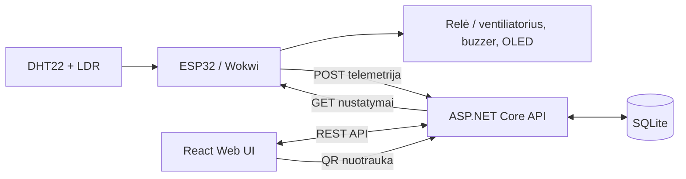
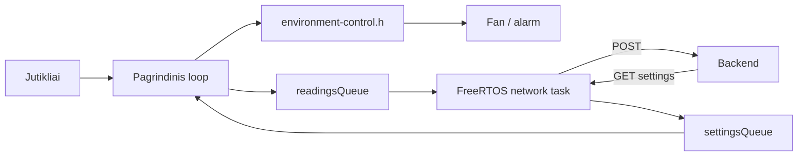

# Muziejaus saugyklos sistemos gidas

Šis dokumentas skirtas greitai suprasti projektą, jį paleisti ir turėti pagrindą ataskaitai.

Projektą sudaro 3 pagrindinės dalys:

- `backend/` – ASP.NET Core REST API ir SQLite duomenų bazė;
- `frontend/` – React vartotojo sąsaja;
- `wokwi/` – ESP32 kiberfizinės sistemos simuliacija.

## Bendra architektūra



Svarbiausias principas: **ventiliatoriaus ir aliarmo sprendimus priima pats ESP32**. Serveris tik pateikia ribines reikšmes ir saugo duomenis. Jei backend neveikia, aplinkos stebėjimas ir apsauga Wokwi simuliacijoje toliau veikia.

---

## `backend/`

Naudojama:

- .NET 10 / ASP.NET Core;
- Entity Framework Core;
- SQLite;
- ZXing + SkiaSharp QR kodų nuskaitymui;
- xUnit testams.

Pagrindinė struktūra:

```text
backend/
├── MuseumStorage.Api/
│   ├── Controllers/   API endpointai
│   ├── Entities/      DB objektai
│   ├── Models/        request/response modeliai
│   ├── Data/          DbContext
│   └── Migrations/    DB migracijos
└── MuseumStorage.Tests/
```

Backend atsakingas už:

- jutiklių matavimų saugojimą;
- aplinkos ribinių reikšmių saugojimą;
- eksponatų, saugojimo zonų ir vietų registrą;
- padėjimo, paėmimo ir perkėlimo operacijas;
- operacijų istoriją;
- QR nuotraukos dekodavimą ir eksponato paiešką.

### Paleidimas

Iš repo šaknies:

```powershell
cd backend/MuseumStorage.Api
```

Pirmą kartą sukurti / atnaujinti DB:

```powershell
dotnet ef database update
```

Paleisti backend:

```powershell
dotnet run --launch-profile http
```

API veiks:

```text
http://localhost:5054
```

> **Pastaba:** dabartiniame projekte HTTPS/TLS nenaudojamas. Backend, frontend ir Wokwi tarpusavyje bendrauja per paprastą HTTP, nes sistema skirta lokaliam prototipui ir demonstracijai. Jei sistema būtų diegiama realioje aplinkoje, reikėtų pridėti HTTPS.

Testai:

```powershell
dotnet test backend/MuseumStorage.slnx
```

---

## `frontend/`

Naudojama:

- React;
- TypeScript;
- Vite;
- React Router;
- CSS.

Frontend turi 3 pagrindinius vaizdus:

```text
/               Aplinkos stebėjimas ir ribinės reikšmės
/exhibits       Eksponatų registras, saugojimo zonos ir vietos
/exhibits/:id   Eksponato informacija, redagavimas ir operacijų istorija
```

Pagrindiniai failai:

```text
frontend/src/
├── main.tsx          routing ir navigacija
├── environment.tsx   jutikliai ir aplinkos nustatymai
├── exhibits.tsx      eksponatai, QR, saugojimo operacijos
├── storage.tsx       saugojimo zonų ir vietų tvarkymas
├── api.ts            HTTP užklausos
├── types.ts          TypeScript duomenų tipai
└── shared.tsx        bendri loading/error helperiai
```

### Paleidimas

Pirmą kartą:

```powershell
npm --prefix frontend ci
```

Paleisti:

```powershell
npm --prefix frontend run dev
```

Atidaryti:

```text
http://localhost:5173
```

Frontend `/api/...` užklausas Vite persiunčia į `http://localhost:5054`.

---

## `wokwi/`

Wokwi simuliuoja fizinę sistemos dalį su ESP32.

Naudojama:

- ESP32 DevKit;
- DHT22 temperatūrai ir drėgmei;
- LDR apšvietimui;
- relay + LED ventiliatoriaus simuliacijai;
- buzzer aliarmui;
- SSD1306 OLED;
- Wi-Fi ir HTTP;
- FreeRTOS network task ir queues.

Pagrindiniai failai:

```text
wokwi/
├── sketch.ino               pagrindinis firmware
├── environment-control.h    fan/alarm logika ir ribinės reikšmės
├── diagram.json             virtuali schema
├── libraries.txt            Arduino bibliotekos
└── wokwi.toml               VS Code Wokwi konfigūracija
```

### Kaip paleisti Wokwi per VS Code

1. VS Code įsidiegti **Wokwi Simulator** extension.
2. Atidaryti `wokwi/` aplanką.
3. Spausti `Ctrl+Shift+P` ir pasirinkti:

```text
Wokwi: Request a new License
```

4. Naršyklėje prisijungti prie Wokwi ir aktyvuoti licenciją.
5. Įsitikinti, kad backend veikia `http://localhost:5054`.
6. Jei `wokwi/bin/` nėra sukompiliuoto firmware, jį reikia sukompiliuoti su Arduino CLI. Detalesnės komandos yra `wokwi/wokwi-project.txt`.
7. Spausti `Ctrl+Shift+P` ir pasirinkti:

```text
Wokwi: Start Simulator
```

Wokwi VS Code extension turi IoT Gateway, todėl ESP32 gali pasiekti lokalų backend per:

```text
http://host.wokwi.internal:5054
```

Serial Monitor turėtų matytis, pvz.:

```text
Wi-Fi connected
Environment settings applied
Telemetry sent
```

### Kaip veikia firmware



`xQueueOverwrite()` naudojamas todėl, kad queue saugoma tik **naujausia** reikšmė. Senų jutiklių matavimų ar senų settings ESP32 kaupti nereikia.

Serverio settings gaunami maždaug kas 30 s, patikrinami ir tik tada perduodami pagrindiniam valdymo ciklui. Jei serveris nepasiekiamas, lieka paskutiniai galiojantys settings.

---

## Ką svarbu suprasti ataskaitai

- ESP32 priima realaus laiko fan/alarm sprendimus lokaliai.
- Backend nėra būtinas aplinkos apsaugai, bet reikalingas duomenų saugojimui ir Web UI.
- Frontend tiesiogiai su DB nebendrauja – viskas vyksta per REST API.
- EF Core naudojamas C# objektams saugoti SQLite DB.
- QR kode saugomas eksponato kodas, pvz. `EXHIBIT-0001`; backend iš nuotraukos iškoduoja QR ir suranda eksponatą.
- Dabartinė fizinė dalis yra **Wokwi ESP32 simuliacija**. Arduino Nano 33 IoT ir realūs laboratorijos komponentai yra galimos fizinės realizacijos variantas, bet dabartinėje demonstracijoje nenaudojami.

## Naudingos nuorodos

- ASP.NET Core Web API: https://learn.microsoft.com/aspnet/core/tutorials/first-web-api
- EF Core: https://learn.microsoft.com/ef/core/get-started/overview/first-app
- React: https://react.dev/learn
- Vite: https://vite.dev/guide/
- Wokwi for VS Code: https://docs.wokwi.com/vscode/getting-started
- Wokwi projekto konfigūracija: https://docs.wokwi.com/vscode/project-config
- ArduinoJson: https://arduinojson.org/v7/tutorial/deserialization/
